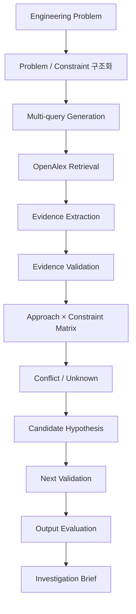

# Semiconductor R&D Copilot

반도체 기술 문제를 **공개 연구 근거로 조사하고, 근거·Trade-off·Unknown·Hypothesis를 구조화하여 다음 검증 의사결정을 지원하는 AI 기반 PoC**입니다.

> AI가 반도체 문제의 정답을 대신 만드는 것이 아니라, 공개 근거를 바탕으로 조사 범위를 줄이고 AI의 오류를 검증하여 사람이 판단해야 할 지점을 더 선명하게 만드는 것이 목표입니다.

## 왜 만들었나

반도체 R&D 문제는 하나의 성능 지표만 개선한다고 끝나지 않습니다. 예를 들어 HBM Thermal 문제는 열 성능뿐 아니라 적층/인터커넥트, 신뢰성, 제조성, 신호 무결성, 비용/수율을 함께 봐야 합니다.

이 프로젝트는 다음 병목을 줄이는 데 초점을 맞춥니다.

```text
기술 문제 발생
  ↓
검색어 설계
  ↓
관련 논문 탐색
  ↓
논문별 근거와 한계 확인
  ↓
기술 접근법 간 Trade-off 비교
  ↓
아직 모르는 것 정리
  ↓
다음 조사/실험 결정
```

## 동작 흐름



HBM Thermal은 시스템에 하드코딩된 규칙이 아니라 `data/cases/hbm_thermal.json`에 저장된 **첫 Benchmark Case**입니다.

## 대표 Case: HBM Thermal Management

문제 정의:

> HBM 적층 수 증가로 내부 열 축적과 thermal resistance가 커질 때 reliability, manufacturability, signal integrity, cost/yield를 함께 고려하여 조사 우선순위를 구조화한다.

Engineering Constraints:

1. Thermal performance
2. Stack / interconnect integration
3. Thermo-mechanical reliability
4. Manufacturability
5. Electrical / signal integrity
6. Cost / yield

## 핵심 평가 결과

### 1. Retrieval V1 → V2

동일한 수작업 검증 Golden Corpus **7편을 고정**하고 검색 전략만 변경했습니다.

| Strategy | V1 Recall@20 | V2 Recall@20 | 변화 |
|---|---:|---:|---:|
| Single keyword | 28.6% | 28.6% | +0.0%p |
| **Multi-query + RRF** | **28.6%** | **71.4%** | **+42.9%p** |
| Semantic | 14.3% | 14.3% | +0.0%p |
| Hybrid + RRF | 42.9% | 71.4% | +28.6%p |

```text
낮은 Recall 발견
  ↓
Golden 7편 Source Coverage 검사
  ↓
7/7 OpenAlex 색인 확인
  ↓
Source 누락이 아닌 Query / Ranking 문제로 분리
  ↓
Concept-family Query + Reciprocal Rank Fusion 적용
  ↓
Recall@20  2/7 → 5/7
Recall@50  3/7 → 6/7
```

현재 HBM Thermal 소규모 Benchmark에서는 `multi_query_rrf_v2`를 기본 검색 전략으로 사용합니다.

### 2. AI Output V1 → V2

동일한 5편과 동일한 Golden Evidence를 유지하고 Evidence Extraction Prompt만 개선했습니다.

| Metric | V1 | V2 |
|---|---:|---:|
| Citation validity | 100% | 100% |
| Constraint precision | 100% | 100% |
| **Constraint recall** | **77.8%** | **94.4%** |
| Constraint F1 | 87.5% | **97.1%** |
| Unsupported mapping | 0 | 0 |
| Hypothesis traceability | 100% | 100% |
| Quality Gate | **FAIL** | **PASS** |

Prompt에 `Constraint Coverage Check`를 추가하여 **과장 없이 누락을 줄이는 방향**으로 개선했습니다.

### 3. End-to-End 최종 Run

| Stage | Result |
|---|---:|
| OpenAlex Source Coverage | **7/7** |
| Retrieval Recall@20 | **5/7 = 71.4%** |
| Downstream Papers | **5** |
| Evidence Accepted / Rejected | **5 / 0** |
| Evidence Validation Errors | **0** |
| Constraint Precision | **100%** |
| Constraint Recall | **94.7%** |
| Constraint F1 | **97.3%** |
| Hypothesis Traceability | **100%** |
| Output Quality Gate | **PASS** |
| Overall Gate | **PASS** |

최종 Run: `runs/hbm_thermal_e2e_final_2026-09-27/`

## AI / Code / Human 역할

| 역할 | 담당 |
|---|---|
| 공학 문제 구조화 | AI + Human Review |
| 검색 Query 후보 생성 | AI / Rule-based |
| 논문 검색 | OpenAlex |
| Evidence 추출 | AI |
| DOI / Paper ID / Constraint / 숫자 검증 | Code |
| Approach × Constraint 합성 | Code |
| Unknown / Hypothesis 생성 | Code + AI-ready Workflow |
| 최종 판단 | Human |

핵심 원칙은 **AI가 생성한 결과를 다시 AI의 말만으로 검증하지 않는 것**입니다. 스키마, 인용, 숫자, Constraint mapping처럼 코드로 확인 가능한 항목은 deterministic evaluator가 우선합니다.

## Demo

### 설치 없이 보기

`demo/index.html`을 브라우저로 열면 검증된 HBM 결과와 V1/V2 평가를 확인할 수 있습니다.

### Streamlit

```bash
pip install -r requirements.txt
streamlit run app.py
```

### Tests

```bash
python -m unittest discover -s tests
```

## 주요 결과 파일

```text
reports/
├─ retrieval_benchmark_v1.md
├─ retrieval_benchmark_v2.md
├─ output_evaluation_v1.md
├─ output_evaluation_v2.md
├─ output_evaluation_v1_vs_v2.md
└─ hbm_thermal_investigation_brief.md

runs/hbm_thermal_e2e_final_2026-09-27/
├─ 04_retrieval_benchmark.json
├─ 06_evidence_validation.json
├─ 07_decision.json
├─ 08_investigation_brief.md
├─ 09_output_evaluation.json
├─ 10_end_to_end_evaluation.json
└─ 11_end_to_end_summary.md
```

## 문서

- [`docs/PROJECT_FLOW.md`](docs/PROJECT_FLOW.md) — 전체 흐름도
- [`docs/ARCHITECTURE.md`](docs/ARCHITECTURE.md) — 내부 구조
- [`docs/SPEC.md`](docs/SPEC.md) — 성공 조건과 Guardrail
- [`docs/GOLDEN_CORPUS_GUIDE.md`](docs/GOLDEN_CORPUS_GUIDE.md) — Golden Corpus 운영 방식
- [`docs/PORTFOLIO_SUMMARY.md`](docs/PORTFOLIO_SUMMARY.md) — 포트폴리오용 요약
- [`docs/DEMO_GUIDE.md`](docs/DEMO_GUIDE.md) — 1~2분 데모 순서

## 한계

- Retrieval Golden Corpus가 7편이라 한 편이 Recall 14.3%p를 차지하는 작은 PoC입니다.
- 최종 downstream은 V2 Top-20에서 회수한 Golden 논문 5편으로 검증했으며, 광범위한 production retrieval 성능을 의미하지 않습니다.
- Evidence Extraction은 production API가 아니라 `browser OpenAlex + manual ChatGPT` 방식으로 수행했습니다.
- Deterministic evaluator는 citation / constraint / numeric / traceability를 검증하지만 자유서술 전체의 의미적 정확성을 완전히 증명하지는 않습니다.
- 결과는 특정 기술의 우열이나 실제 공정 root cause를 확정하지 않습니다.

## 핵심 원칙

1. 단일 검색 Query에 의존하지 않습니다.
2. 검색 품질 자체를 Golden Corpus로 평가합니다.
3. Fact / Inference / Hypothesis를 구분합니다.
4. Evidence가 없으면 Unknown으로 남깁니다.
5. Conflict를 임의로 하나의 결론으로 합치지 않습니다.
6. 검증 가능한 항목은 LLM Judge보다 코드 검증을 우선합니다.
7. Golden 논문 제목을 보고 검색어를 역설계하지 않습니다.
