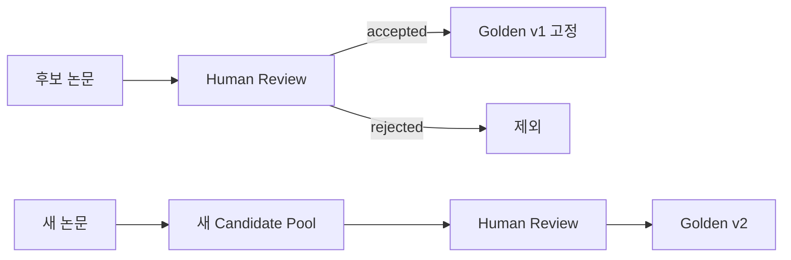

# Golden Corpus Guide

## 역할

```mermaid
flowchart LR
    A[OpenAlex 최신 전체 검색] --> B[실제 서비스 Retrieval]
    C[사람이 검증한 Golden Corpus] --> D[검색 품질 평가]
    B --> D
    D --> E[Recall@K]
```

Golden Corpus는 검색 범위를 제한하는 지식 DB가 아니라 **고정된 평가 Benchmark**입니다.

## 버전 관리



현재 `evals/golden/hbm_thermal/v1/candidates.jsonl`은 아직 Golden이 아니라 **사람 검토가 필요한 후보 10편**입니다.

검토 시 각 후보에서 다음만 확인합니다.

1. 문제와 직접/보조적으로 관련 있는가?
2. 실제 claim을 abstract/full text에서 확인 가능한가?
3. 어떤 Constraint에 근거를 제공하는가?
4. 특정 조건의 결과를 과도하게 일반화하지 않는가?

`review_status`는 `accepted`, `rejected`, `abstract_only`, `needs_full_text` 중 하나로 관리합니다.
