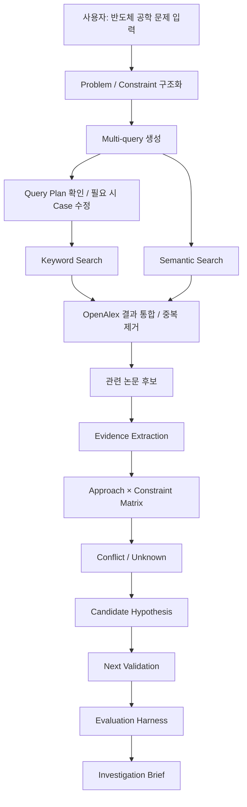
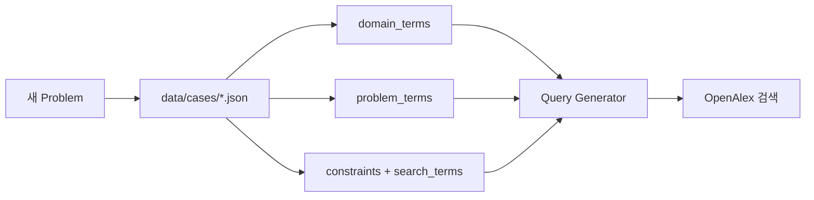
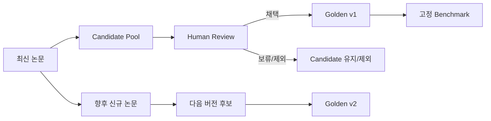

# Project Flow

이 문서는 프로젝트를 처음 보는 사람이 전체 흐름을 빠르게 이해하기 위한 문서입니다.

## 1. 사용 흐름



## 2. 새로운 공학 문제 / 제약조건



- HBM Thermal은 첫 번째 Benchmark Case일 뿐 시스템에 고정된 규칙이 아닙니다.
- 새 Constraint에 `search_terms`를 추가하면 focused query가 자동 생성됩니다.
- 이후 LLM은 이 Case 구조를 자동 생성/보완하는 역할로 연결합니다.

## 3. 검색 품질 관리

```mermaid
flowchart TD
    A[Problem] --> B[여러 Keyword Query]
    A --> C[Semantic Query]
    B --> D[검색 결과]
    C --> D
    D --> E[Golden Corpus와 비교]
    E --> F[Recall@K]
    F -->|낮음| G[용어 / Query 수정]
    G --> B
    F -->|충분| H[Evidence 단계 진행]
```

단일 AI 검색어를 신뢰하지 않고 여러 검색 전략을 합친 뒤 검색 품질도 평가합니다.

## 4. Golden Corpus 생명주기



- Golden Corpus는 실제 검색 대상을 제한하지 않습니다.
- 확정된 버전은 수정하지 않고 다음 버전을 새로 만듭니다.
- 새 공학 문제는 Golden Corpus 없이도 실행할 수 있으며, Golden은 품질 평가용입니다.
